  

<h1 align="center">Hi, I'm Navneeta 👋</h1>

  <b>B.Tech CSE (AI/ML) | AI/ML Development | Software Engineering</b>

  Building practical applications at the intersection of machine learning,
  backend engineering, and applied AI.

---

## About Me

- 🎓 Pursuing B.Tech in Computer Science and Engineering (AI/ML) at GLBITM.
- 🧠 Interested in applied machine learning, AI engineering, and backend development.
- 🛠️ Building projects that turn technical ideas into usable applications.
- 📚 Strengthening my problem-solving skills through DSA and coding practice.

## Featured Projects

### FraudShield — Machine Learning
A practical ML project focused on fraud detection.

- Focus: dataset preparation, feature engineering, model evaluation, and responsible predictions.
- Status: project under development; features and metrics will reflect the implemented version.

### ClauseClear — AI-Assisted Contract Analysis
An application designed to help users understand legal documents.

- Features: contract summaries, risk identification, document Q&A, and checklists.
- Technologies: React, Flask, Groq/Llama, and AWS S3, subject to verification against the current implementation.
- Note: provides informational assistance, not legal advice.

### RiderSaathi — Mobility Assistance
A project exploring technology-assisted mobility and user support.

- Focus: practical application development and integration.
- Contributions and technologies: see the project repository.

## Achievements & Recognition

- 🏆 Prompt Wars — Rank 456 out of 1,752 participants.
- 📜 WeMakeDevs First Commit — Certificate of Participation, October 2026.
- 💻 LeetCode — 70+ problems solved previously; see my profile for current activity.

## Technical Skills

**Programming:** Python, C++, C, JavaScript

**AI / ML:** Machine learning and applied AI

**Web Development:** HTML, CSS, JavaScript, React

**Backend:** Python, Flask, REST APIs

**Cloud & Tools:** AWS, Git, GitHub

*Skills and project-specific technologies should be updated to match my current, verified experience.*

## Coding & Connect

  <a href="https://github.com/navneeta88">
    GitHub
  </a>
  &nbsp; • &nbsp;
  <a href="https://github.com/navneeta88/Portfolio">
    Portfolio Repository
  </a>
  &nbsp; • &nbsp;
  <a href="http://linkedin.com/in/navneeta-mohapatra-">
    LinkedIn
  </a>

---

  <i>Learning continuously. Building thoughtfully. Improving with every iteration.</i>

